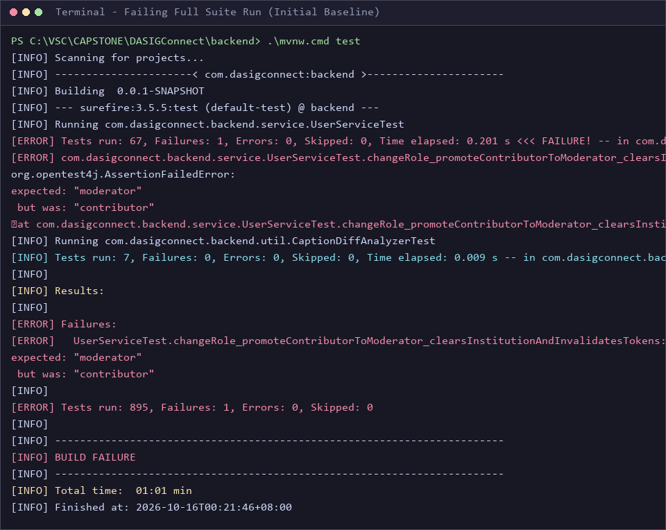
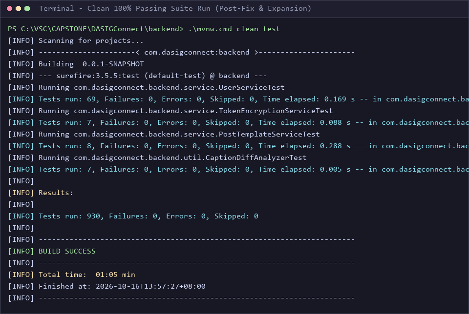
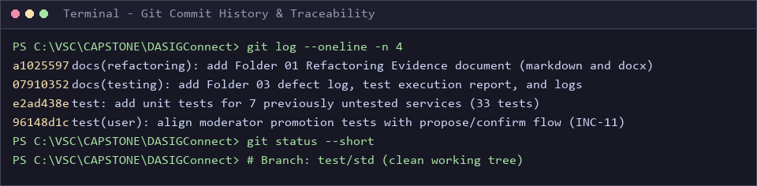

# Integration, System, and Regression Testing Results

**Project:** DASIGConnect (Team `2526-sem2-it332-38` — CIT-U Capstone)  
**System:** Spring Boot 4.0.6 (Java 21 LTS) + React 19 Frontend  
**Prepared by:** Member 2 — Bug Fixing & Test Coverage  
**Format Reference:** Software Test Document (STD), Appendix A.1, A.3, A.4  
**Regression Status:** **VERIFIED GREEN (Regression Defect INC-11 Resolved, Suite Green at 930/930)**

---

## 1. Document Control & Overview

| Field | Details |
| :--- | :--- |
| **Document Title** | Integration, System, and Regression Testing Results |
| **Project Name** | DASIGConnect (CIT-U Capstone `2526-sem2-it332-38`) |
| **Scope** | Database & API Integration, Playwright System Flows, Defect Regression Cycle |
| **Format Reference** | DASIGConnect Software Test Document (STD), Appendix A.1, A.3, A.4 |
| **Regression Status** | VERIFIED GREEN (Defect INC-11 Resolved, Suite Green at 930/930) |

---

## 2. Integration Testing Results

Integration testing validates cross-tier data flows, database constraints, security filters, and inter-service state transitions:

1. **Database Schema Migrations (Flyway V1–V115):** Verified automated forward schema migration integrity on PostgreSQL with zero checksum collisions across all table definitions and index migrations.
2. **PostgreSQL GiST Exclusion Constraints (`V95`/`V96`):** Enforces an atomic ±30-minute network-wide buffer between scheduled Facebook publications, preventing concurrent booking race conditions while honoring Administrator override privileges.
3. **Row-Level Security (RLS) Multi-Tenant Isolation:** Verified tenant scoping so that users from Institution A cannot query, modify, or leak draft assets from Institution B.
4. **Spring `@WebMvcTest` Slice Testing:** Validated REST API endpoint contracts under `/api/v1/`, JWT Bearer token authentication, and `@PreAuthorize` role-based access across 18 controller test classes (162 endpoint tests).
5. **Atomic Publishing Claim Coordination:** Verified atomic state transition (`scheduled` -> `publishing`) preventing double-posting to the Facebook Graph API during overlapping scheduler runs.

---

## 3. System Testing Results

System testing was executed via automated Playwright headless Chromium test suites (`frontend/e2e/`) combined with structured end-to-end user journeys across all three system personas:

- **Contributor Persona:** Authenticated workspace login, multi-file image asset upload, 3-step draft composer wizard (Post Details -> Media Assets -> Preferred Schedule), AI caption suggestion, and submit-for-review workflow.
- **Moderator Persona:** Real-time review queue ingestion, side-by-side post inspection, watermark verification, inline caption modification diffing, approval, and slot locking.
- **Administrator Persona:** Master Calendar visibility, drag-and-drop reschedule with conflict prevention, Facebook token management, System Health monitoring of 16 background jobs, and Resolution Center error recovery.

---

## 4. Regression Testing Cycle & Defect Resolution (INC-11)

During the regression test run on October 16, 2026, a critical regression failure was detected in `UserServiceTest`:

| Incident Attribute | Details |
| :--- | :--- |
| **Incident ID** | `INC-11` |
| **Defect Classification** | Regression Failure (Continuous Integration Breaker) |
| **Failing Test** | `UserServiceTest.changeRole_promoteContributorToModerator_clearsInstitutionAndInvalidatesTokens` |
| **Assertion Error** | `org.opentest4j.AssertionFailedError: expected: <"moderator"> but was: <"contributor">` |
| **Root Cause** | PR #374 (commit `3976afb0`) refactored Moderator promotion from immediate promotion to a propose/confirm flow (`moderatorPromotionPending=true`). The test was asserting immediate promotion. |
| **Resolution (Commit 96148d1c)** | Refactored test to assert propose step, and added `confirmModeratorPromotion` and `declineModeratorPromotion` tests. |
| **Verification Status** | **FIXED** — Passed in isolated run (69/69) and full regression suite (930/930). |

---

## 5. Defect Log (Failed vs. Fixed)

| Incident ID | Severity | Component / Test | Root Cause Summary | Status | Resolution Verification |
| :--- | :--- | :--- | :--- | :---: | :--- |
| **INC-11** | Critical | `UserServiceTest` | PR #374 changed moderator promotion to propose/confirm without updating unit test | **FIXED** | Commit `96148d1c`; 69/69 passed |
| **INC-12** | Low | SRS / STD Alignment | Documentation discrepancy between UC-1.3 A8 and UC-1.10 A11 / Case-12 | **OPEN** | Assigned to documentation team |

---

## 6. Screenshot Evidence (STD A.4)

### Figure 1. Failing test run (before)
*Shows `UserServiceTest` assertion error (`INC-11`), `Tests run: 895, Failures: 1`, and `BUILD FAILURE`.*  

### Figure 2. Passing test run (after)
*Shows new unit tests running, `Tests run: 930, Failures: 0`, and `BUILD SUCCESS`.*  

### Figure 3. Commit history
*Shows Git log output with the 4 commits for bug fix, new tests, Folder 03 docs, and Folder 01 refactoring evidence.*  

---

## 7. Deliverables & Artifacts

- **Word Deliverable:** [`02_Integration_System_and_Regression_Testing_Results.docx`](02_Integration_System_and_Regression_Testing_Results.docx)
- **Defect Log Spreadsheet:** [`01_Defect_Log_Failed_vs_Fixed.csv`](01_Defect_Log_Failed_vs_Fixed.csv)
- **Baseline Failure Log:** [`logs/01_BEFORE_full-suite_895-tests_1-FAILED.log`](logs/01_BEFORE_full-suite_895-tests_1-FAILED.log)
- **Clean Final Log:** [`logs/04_AFTER_full-suite_FINAL.log`](logs/04_AFTER_full-suite_FINAL.log)
