# DASIGConnect — Slide Deck & Live Presentation Script

> **Target Runtime:** ~4 minutes 35 seconds (strictly under the 5:00 limit)  
> **Slide Count:** 9 high-impact slides (minimal text, visual-first)  
> **Positioning:** B2B / Institutional SaaS Startup — *Decentralized Content Collection, Centralized Brand Control*  
> **Note:** For the pre-recorded video (with roleplay cold open & creative interruption), use the separate **Video Script** artifact.

---

## Live Presentation Flow & Pacing (4:35 Total)

```mermaid
flowchart LR
    S1["1. The Story & Hook (0:00–0:35)"] --> S2["2. Problem (0:35–1:05)"]
    S2 --> S3["3. Solution & UVP (1:05–1:35)"]
    S3 --> S4["4. Live Product Demo (1:35–2:30)"]
    S4 --> S5["5. Target Market (2:30–3:05)"]
    S5 --> S6["6. Business Model (3:05–3:40)"]
    S6 --> S7["7. Competitive Edge (3:40–4:05)"]
    S7 --> S8["8. Go-To-Market (4:05–4:25)"]
    S8 --> S9["9. Vision & Ask (4:25–4:35)"]
```

---

## Slide-by-Slide Deck & Spoken Script

### Slide 1: The Story & Hook (`0:00 – 0:35`)
**Slide Visual:**  
- Minimalist split-screen visual: Left side shows a chaotic group chat ("Where are the photos?!") + an empty social feed; Right side shows **DASIGConnect** logo and tagline: *"Every Partner Story. Published on Time."*

**Spoken Script:**
> "Imagine it's Monday morning. A university research team just launched a breakthrough innovation project. Photos are taken, excitement is high—and then… nothing gets posted. The photos sit in a group chat, the caption gets lost in email, and by Friday, the moment is gone.
>
> Multiply that across *dozens* of partner universities, regional agencies, or branch offices sharing one public brand—and your organization becomes invisible online.
>
> We built **DASIGConnect** to fix that. We turn scattered partner updates into a fast, AI-powered publishing engine."

---

### Slide 2: The Problem (`0:35 – 1:05`)
**Slide Visual:**  
- **Headline:** Multi-Organization Networks Have a Content Bottleneck  
- **3 Bold Stat/Pain Callouts (max 5 words each):**
  1. **Delayed Coverage** — *Events posted days too late*
  2. **Incomplete Posts** — *Missing photos & weak captions*
  3. **Zero Accountability** — *No review or audit trail*

**Spoken Script:**
> "Traditional social media tools are built for *one* marketing team managing *one* brand. They break down completely for **multi-organization networks**—like regional science consortia, university alliances, government networks, and multi-chapter nonprofits.
>
> Today, these networks suffer from delayed event coverage, incomplete posts with missing media, and irregular publishing—all because they rely on ad-hoc chats and spreadsheets with no structured way to submit, validate, and schedule content."

---

### Slide 3: The Solution & UVP (`1:05 – 1:35`)
**Slide Visual:**  
- **Headline:** Decentralized Collection. Centralized Control.  
- **Visual:** Clean 4-icon flow: `Submit (Partner)` → `Validate (Lead)` → `AI-Enrich (Claude + Voyage)` → `Auto-Publish (Calendar)`  
- **UVP Badge:** *"The only publishing platform engineered for multi-institution networks."*

**Spoken Script:**
> "**DASIGConnect** is a B2B workflow and AI publishing platform built specifically for networked organizations.
>
> Partner institutions submit event drafts inside their own isolated workspace. Built-in AI writes captions and finds matching photos from past archives. Validators approve or request revisions in real time, and approved posts auto-publish to social channels on schedule.
>
> Our Unique Value Proposition is simple: **we give central brands full quality control without slowing down their partners.**"

---

### Slide 4: Live Product Demo (`1:35 – 2:30`)
**Slide Visual / Screen Recording (55 seconds total):**  
*Keep this fast and energetic—show real screens, not bullet points!*
- **0:00–0:15 (Submit + AI):** Contributor enters event details, drops multiple photos, clicks **AI Caption** (Claude Vision generates caption + tags), and sees **AI Media Suggestions** (Voyage AI + vector search surfaces relevant past photos).
- **0:15–0:30 (Validate + Real-Time Alerts):** Switch to Admin/Validator queue → click **Approve** (or show Request Revision) → real-time notification bell updates instantly via SSE.
- **0:30–0:45 (Calendar + Auto-Publish):** Show approved post on the **Visual Calendar** with conflict detection → transitions to **Published** on Facebook automatically (with duplicate-publish protection).
- **0:45–0:55 (Analytics):** Quick glance at the **Analytics Dashboard** (posting frequency, turnaround time, completeness rate).

**Spoken Script:**
> "Let's see it in action. A partner contributor opens our 3-step wizard, enters the event details, and drops in their photos. With one click, **Claude Vision** analyzes the images to draft a ready-to-edit caption and auto-tags them. Need stronger visuals? Our **multimodal AI search** scans the centralized media repository and recommends the top five most relevant past photos in seconds.
>
> Next, validators review the submission in a clean queue—approving or requesting revisions with instant in-app and email alerts. Approved posts land on our **Visual Calendar** with conflict detection, then auto-publish to Facebook with built-in duplicate-post protection—while our analytics dashboard tracks turnaround time and content completeness."

---

### Slide 5: Target Market & Business Opportunity (`2:30 – 3:05`)
**Slide Visual:**  
- **Headline:** A Growing Market of Networked Brands  
- **Concentric Circles (SOM → SAM → TAM):**
  - **Beachhead (SOM):** Regional R&D Consortia & Higher Education Networks in the Philippines *(Starting with DOST Region 7's DASIG — CIT-U, Silliman University & partner HEIs)*
  - **Serviceable Market (SAM):** 1,900+ Philippine HEIs, 16 DOST Regional Consortia, LGUs, and multi-chapter NGOs across Southeast Asia
  - **Total Market (TAM):** Global multi-branch enterprises, franchises, associations, and public-sector networks needing distributed content governance

> [!NOTE]
> *Presenter Tip:* If you have specific local budget or pricing survey numbers from your proposal, swap them into the circles above—otherwise keep the framing focused on verifiable institutional counts (e.g., 16 DOST regions, ~1,900+ Philippine HEIs) and the global multi-location SaaS demand.

**Spoken Script:**
> "Who is this for, and how big is the opportunity?
>
> Our beachhead market is **academic and government innovation networks**—starting with our flagship validation partner, **DASIG under DOST Region 7**, which coordinates content across member universities like CIT-U and Silliman University.
>
> Beyond Region 7, there are **16 DOST regional networks**, nearly **2,000 Higher Education Institutions** in the Philippines alone, plus thousands of local government units, multi-chapter NGOs, and franchise brands across Southeast Asia—all facing the exact same distributed content bottleneck."

---

### Slide 6: Business Model & Revenue Strategy (`3:05 – 3:40`)
**Slide Visual:**  
- **Headline:** Scalable Hub-and-Spoke SaaS Model  
- **3 Clean Pricing Cards (Illustrative B2B Tiers):**
  - **Starter Network** *(Up to 5 Partner Orgs)* — Monthly/Annual SaaS Subscription
  - **Growth Consortium** *(Up to 25 Partner Orgs + Full AI Suite)* — Core Mid-Market Tier
  - **Enterprise / Gov** *(Unlimited Orgs + Custom Onboarding & SLA)* — Annual Contract
- **Secondary Revenue:** Onboarding & Integration Setup · Extra AI/Storage Packs · White-Label Analytics

**Spoken Script:**
> "We monetize through a **hub-and-spoke B2B SaaS model**. Instead of charging per individual social post, we charge the **central network hub** a recurring subscription based on the number of member institutions or branches.
>
> Our **Starter** and **Growth** tiers serve university alliances, NGOs, and regional consortia, while our **Enterprise and Government** tier offers annual contracts with unlimited member workspaces, custom onboarding, and dedicated support.
>
> Because our cloud and AI infrastructure scales on usage, gross margins remain strong as each hub adds more partner organizations—making the business financially sustainable and predictable."

---

### Slide 7: Competitive Advantage (`3:40 – 4:05`)
**Slide Visual:**  
- **Headline:** Why We Win  
- **Simple 4-Row Comparison Matrix:**  
  *Columns:* `Feature` | `Chat / Drive` | `Buffer / Hootsuite` | `DASIGConnect`
  1. Multi-Institution Tenant Isolation | ❌ | ❌ | ✅
  2. Contributor → Validator → Admin Pipeline | ❌ | ⚠️ Basic | ✅
  3. AI Multimodal Media Memory & Suggestions | ❌ | ❌ | ✅
  4. Conflict-Free Auto-Publish + Audit Trail | ❌ | ⚠️ Single Team | ✅

**Spoken Script:**
> "Why can't organizations just use Hootsuite, Buffer, or Meta Business Suite?
>
> Because those tools assume everyone works for *one* company. They don't offer **tenant-isolated partner workspaces**, multi-tier institutional validation, or **AI media memory** that resurfaces relevant archived photos across dozens of contributors.
>
> DASIGConnect is purpose-built for networked brands—combining strict governance with AI speed."

---

### Slide 8: Go-To-Market Strategy (`4:05 – 4:25`)
**Slide Visual:**  
- **Headline:** Land, Prove, Replicate  
- **3-Step Timeline:**
  1. **Phase 1 — Beachhead Proof:** Deploy & measure impact with **DOST Region 7 (DASIG)** → publish case study.
  2. **Phase 2 — Network Expansion:** Pitch to **DOST Regional Consortia**, **SUCs/HEIs**, and **LGU clusters** via warm institutional referrals.
  3. **Phase 3 — Commercial Scale:** Self-serve onboarding for **NGOs, associations, and multi-branch businesses**.

**Spoken Script:**
> "Our go-to-market strategy follows three practical steps:
>
> **First**, we prove measurable impact—faster turnaround and higher post completeness—with our flagship partner, **DOST Region 7's DASIG**. **Second**, we turn that case study into warm referrals across other DOST regions, university networks, and government clusters. **Third**, we open self-serve SaaS onboarding for NGOs and multi-branch commercial brands."

---

### Slide 9: Vision & Call to Action (`4:25 – 4:35`)
**Slide Visual:**  
- **Headline:** DASIGConnect  
- **Subhead:** *Powering the voice of every networked organization.*  
- **Call to Action:** Looking for Pilot Partners & Seed Support to scale nationwide.

**Spoken Script:**
> "Every great innovation deserves to be seen on time. With **DASIGConnect**, we're turning fragmented partner networks into unified storytelling engines. Join us as we scale from Region 7 to networks everywhere. Thank you."

---

## Live Presentation Delivery Tips
- **Open with energy:** Deliver Slide 1's Monday-morning story without looking at the slides—make eye contact with the judges/investors.
- **Keep slides clean:** Use the **Slide Visual** notes above literally—big headlines, icons, and 3–5 word bullets. Let your **voice** carry the detail.
- **Demo backup:** Have a 55-second pre-recorded screen clip embedded on Slide 4 so you never lose time to live Wi-Fi or login delays during a strict 5-minute pitch.
- **Time check:** At a natural speaking pace (~145 words/min), this script lands around **4:25–4:40**, leaving a safe buffer under the 5:00 cap.
