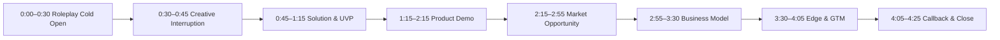

# DASIGConnect — Creative Video Script (Roleplay + Pitch)

> **Target Runtime:** ~4 minutes 25 seconds (strictly under the 5:00 limit)  
> **Cast:** 1–3 people (Presenter + 2 quick roleplay characters, or 1 person playing both with outfit/angle swaps)  
> **Style:** Roleplay Cold Open → Freeze-Frame Interruption → Fast-Paced Pitch & Demo → Callback Ending

---

## Video Flow

---

## Scene-by-Scene Script

### Scene 1: Roleplay Cold Open — *"Monday Morning Chaos"* (`0:00 – 0:30`)
**Characters:**
- **MARA** (University Comms Coordinator)
- **LEO** (Central Network Admin)

**Visual & Action:**
- **[0:00 – 0:10]** *Quick, energetic shot.* **MARA** is at a campus event holding a phone, smiling.
  - **MARA:** *(into voice note / typing fast)* "Hey Leo! The robotics summit just wrapped—huge turnout! Sending the photos now!"
- **[0:10 – 0:20]** *Hard cut to "3 DAYS LATER" title card.* **LEO** is staring at his laptop, stressed, surrounded by open chat tabs and folders.
  - **LEO:** *(frustrated, typing)* "Mara, where are the high-res photos? Who wrote the caption? Wait—did Silliman send theirs too? The event was *three days ago*!"
- **[0:20 – 0:30]** Notifications ping nonstop. Leo hovers his mouse over an incomplete, photo-less draft, sighs, and reaches to click "Post Anyway"—

---

### Scene 2: The Creative Interruption — *"Stop Right There"* (`0:30 – 0:45`)
**SFX & Visual:**
- *RECORD SCRATCH!* The screen **freezes in grayscale** right before Leo clicks.
- **PRESENTER** walks into frame (or pops into a crisp center-screen overlay), looking directly into the camera.

**Spoken Script:**
> **PRESENTER:** "Hold on—stop right there. Have you ever watched a brilliant university or research event happen on Monday… only for it to hit social media on Friday with half the photos missing?
>
> That's not a people problem. It's a **workflow problem**—and it's costing entire organization networks their visibility. Let's rewind and fix this with **DASIGConnect**."

*(SFX: Quick rewind whoosh → freeze-frame shatters into the clean DASIGConnect logo.)*

---

### Scene 3: What the Pitch Is All About (`0:45 – 1:15`)
**Visual:**
- Presenter on camera (or voiceover over clean motion graphics showing multiple universities/offices feeding into one central social hub).

**Spoken Script:**
> **PRESENTER:** "**DASIGConnect** is a B2B SaaS platform built for **multi-organization networks**—alliances, university consortia, government agencies, and multi-branch brands that share one public voice.
>
> Traditional tools like Buffer or Hootsuite are built for *one* marketing team. They break down when dozens of independent partners need to submit content.
>
> Our Unique Value Proposition? **Decentralized content collection, with centralized brand control.**"

---

### Scene 4: Product Demo — *"The Rewind"* (`1:15 – 2:15`)
**Visual (Screen Recording — keep cuts snappy, 8–12 seconds per beat):**
1. **Submit (0:15):** Show Mara's screen—she opens the **3-step submission wizard**, fills in *Post Details*, and drops multiple event photos at once.
2. **AI Magic (0:15):** Click **AI Caption**—**Claude Vision** generates a polished caption and auto-tags the images. Then show **AI Media Suggestions** (**Voyage AI + pgvector**) pulling the top 5 matching photos from the centralized repository.
3. **Validate & Alert (0:15):** Cut to Leo's **Validation Queue**—he clicks **Approve**, and the notification bell updates in real time via **Server-Sent Events**.
4. **Calendar, Auto-Publish & Analytics (0:15):** Show the **Visual Calendar** with conflict detection, automatic **Facebook publishing** (with duplicate-post protection), and a quick pan across the **Analytics Dashboard**.

**Spoken Script:**
> **PRESENTER (VO):** "Let's replay Mara's Monday with DASIGConnect.
>
> Inside her institution's isolated workspace, Mara enters the event details and drops her photos. With one click, **Claude Vision** writes a ready-to-edit caption and auto-tags the media. Missing a shot? Our **multimodal AI search** scans the shared repository and recommends the five most relevant past photos in seconds.
>
> Leo gets an instant alert, reviews the post in his validation queue, and approves it with one click. It lands on our **Visual Calendar** with conflict detection, then auto-publishes to Facebook on schedule—zero duplicate posts, zero chasing people in group chats, and full analytics on turnaround time."

---

### Scene 5: Target Market & Business Opportunity (`2:15 – 2:55`)
**Visual:**
- Clean animated map/graphic: Region 7 → Philippines → Southeast Asia & Global, with callout numbers.

**Spoken Script:**
> **PRESENTER:** "Who needs this, and how big is the market?
>
> We're starting with **academic and innovation networks**—our beachhead partner is **DASIG under DOST Region 7**, coordinating content across member universities like CIT-U and Silliman University.
>
> From there, we expand to **16 DOST regional consortia** and **nearly 2,000 Higher Education Institutions** in the Philippines alone—plus local government clusters, multi-chapter NGOs, and franchise networks across Southeast Asia that all face the exact same distributed publishing bottleneck."

---

### Scene 6: Business Model & Revenue Strategy (`2:55 – 3:30`)
**Visual:**
- Show 3 clean pricing tier cards (*Starter Network*, *Growth Consortium*, *Enterprise / Gov*) + secondary revenue icons.

**Spoken Script:**
> **PRESENTER:** "How do we make money? Through a scalable **hub-and-spoke B2B SaaS model**.
>
> Instead of charging per post, we charge the **central network hub** a recurring subscription based on how many member institutions or branches they connect—across Starter, Growth, and Enterprise Government tiers.
>
> We layer on paid onboarding, extra AI and storage packs, and white-label analytics. Because our cloud and AI costs scale efficiently per hub, our margins grow as networks expand."

---

### Scene 7: Competitive Advantage & Go-To-Market (`3:30 – 4:05`)
**Visual:**
- Quick 4-row check/cross comparison graphic (`Chat/Drive` vs. `Buffer/Hootsuite` vs. `DASIGConnect`), followed by a 3-step roadmap.

**Spoken Script:**
> **PRESENTER:** "Unlike generic schedulers, DASIGConnect gives networks **multi-tenant partner isolation**, structured **Contributor-to-Validator-to-Admin** approvals, and **AI media memory** that reuses institutional assets automatically.
>
> Our go-to-market is practical: **First**, prove measurable turnaround gains with DOST Region 7. **Second**, expand to other DOST consortia and university systems through warm referrals. **Third**, open self-serve SaaS for NGOs and multi-branch brands."

---

### Scene 8: Callback Ending & Call to Action (`4:05 – 4:25`)
**Visual & Action:**
- Cut back to **LEO** from Scene 1—same desk, now completely calm. His phone buzzes once: *"DASIGConnect: Post published on schedule."* He smiles and takes a sip of coffee.
- Cut to **PRESENTER** + **DASIGConnect** logo.

**Spoken Script:**
> **PRESENTER:** "No more chasing photos. No more late posts. Just every partner story, published on time.
>
> We're **DASIGConnect**—and we're ready to scale from Region 7 to networks everywhere. Thank you."
